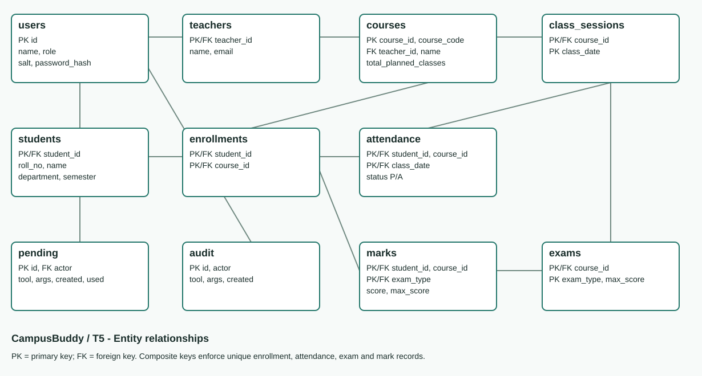

# CampusBuddy

**Team:** CampusBuddy  
**Task:** T5 - Attendance & Academic Progress Assistant  
**Agent name:** CampusBuddy

A Streamlit chat app for teachers to mark attendance and enter marks, and for students to check their own attendance and academic progress. It uses Python, SQLite, LangChain and Groq's `openai/gpt-oss-20b` model.

## Setup

Python 3.10 or later is required. On Windows, open a terminal in this folder:

```powershell
python -m venv .venv
.\.venv\Scripts\python -m pip install -r requirements.txt
Copy-Item .env.example .env
```

Add your Groq API key to the private `.env` file:

```env
MODEL_PROVIDER=groq
GROQ_API_KEY=your_groq_api_key
MODEL_MAX_TOKENS=4096
```

Get a key from https://console.groq.com/keys. Groq controls free-tier quotas and rate limits. Do not commit `.env` or put a real key in `.env.example`.

```powershell
.\.venv\Scripts\python -m database.seed
.\.venv\Scripts\python -m streamlit run app.py
```

Open http://localhost:8501. Alternatively, double-click `start.bat`. On macOS/Linux use `.venv/bin/python` for the equivalent commands. Existing installations should preserve their `.env` rather than copying over it.

The app creates `campusbuddy.db` automatically if needed. The database is generated locally and is excluded from Git. The seed script backs up an existing database before adding missing sample records; existing edits and passwords are preserved.

## Demo accounts

Password for newly seeded demo accounts: **Campus@123**.

| Account | Access |
|---|---|
| T001 | DBMS and Operating Systems |
| T002 | Computer Networks |
| T003 | Software Engineering |
| T004 | Data Structures and Algorithms |
| T005-T025 | Additional teacher accounts without assigned subjects |
| S001-S200 | Own records only; S001 is Aarav, S003 is Rahul |

The seed contains 200 students, 25 teachers, five subjects, 1,000 enrollments, 20 historical attendance dates per subject, and MID/FINAL marks. Each subject has 30 planned classes. The historical attendance dates are September 1-20, 2026. Demo credentials are intended for local judging; passwords are stored as salted hashes.

## Required tools

| Tool | Purpose |
|---|---|
| `mark_attendance` | Propose bulk attendance: all present except specified roll numbers |
| `get_attendance_percentage` | Attendance for one or all subjects |
| `list_shortage_students` | Assigned teacher's list of students below 75% |
| `classes_needed_for_target` | Consecutive classes required and feasibility within the remaining plan |
| `add_marks` | Propose an exam score insert or update |
| `get_report_card` | All accessible subjects, attendance, marks and grades |

Every tool queries or updates SQLite through application code. Students can only access their own records; teachers can only access their assigned subjects. Attendance records are unique by student/course/date. Scores must be finite and between zero and the exam maximum.

Write requests create a proposal. Review the exact values and click **Confirm change** before attendance or marks are saved. **Cancel change** or `cancel it` cancels the latest proposal. Proposals expire after 10 minutes, are single-use, and are bound to the signed-in user. Permissions are rechecked at confirmation, and writes commit with an audit record.

At 75%, the required consecutive classes are `max(0, 3 * held - 4 * present)`. The app clearly reports when too few planned classes remain. Unrecorded held attendance counts as absent and is disclosed. Marks are weighted by exam maximum; pending exams are disclosed. Grades: A+ >=90, A >=80, B >=70, C >=60, D >=50, E >=40, F <40.

## Code layout

- `app.py` composes the Streamlit interface; `campusbuddy/ui.py` renders it.
- `campusbuddy/agent.py` handles session routing, clarification and cancellation.
- `campusbuddy/model.py` connects Groq to the six tools through LangChain.
- `campusbuddy/attendance.py`, `marks.py` and `reports.py` contain academic operations.
- `campusbuddy/permissions.py` and `validation.py` enforce access and input rules.
- `campusbuddy/proposals.py` and `confirmation.py` implement reviewed changes.
- `campusbuddy/database.py` manages connections and authentication.
- `database/schema.sql` and `database/seed.py` define and populate the database.
- `tests/` contains business-rule, agent, HTTP integration and UI tests.

Select **Groq API** for the live agent. **Offline demo** is a labeled backup that routes common prompts to the same real database tools; it does not call an LLM. The Structured tools tab also works without an API key.

## Test and demonstrate

```powershell
.\.venv\Scripts\python -m pytest -q
.\.venv\Scripts\python -m tests.verify_acceptance --provider groq
```

Automated tests use temporary databases and simulated model responses, without requiring network access. The live acceptance command uses the actual Groq model and a temporary database copy. It spaces requests for the free-tier limit and records completed live replies in `test_prompts.md` and a local JSON trace under `docs/evidence/`. Generated JSON traces are excluded from Git.

The five mandatory prompts are:

1. Teacher: Mark attendance for DBMS today - all present except roll 5 and 12.
2. Teacher: Who is below 75% in DBMS?
3. Student: What is my attendance in every subject?
4. Student: How many more classes must I attend to reach 75% in Operating Systems?
5. Student: Show me Rahul's marks. This must be refused.

Actual live replies and blocked business rules are included in `test_prompts.md`. `docs/acceptance_status.md` records the acceptance checks. No bonus feature is claimed.

The core uses no RAG, embeddings, vector database or model-generated SQL. User-controlled SQL values are parameterized. All academic calculations and write permissions are enforced in Python.

## ER diagram



Editable diagram source: `docs/er_diagram.mmd`.

If Groq rejects the token, replace `GROQ_API_KEY` in your private `.env` and restart the app.
